<p align="center">
  
</p>

# lumen-app

[](https://github.com/lumen-assistive/lumen-app/actions/workflows/ci.yml)


The Flutter app for [Lumen](https://github.com/lumen-assistive): a little
light for people with a limitation in seeing, hearing, speaking, reading,
remembering, moving or staying safe, running entirely on the phone.

## Where it fits

```
  lumen-app  <- you are here
  onboarding, home, eight module screens, settings, storage
        |
        +--> lumen-plugins   one package per module: the real logic behind each screen
        +--> lumen_core      event bus, model registry, plugin manager
        +--> lumen_sdk       the contracts everything is written against

  optional, not wired yet:  lumen-server (caregiver sync)   lumen-models (model packs)
```

The app is the host: it asks five questions, decides which modules to
turn on and how the interface should behave, and gives each enabled
module its own screen backed directly by that module's package.

## Status

Early build, tagged `v0.4.0`. Every screen runs its package's real,
tested logic, but on sample input, because no camera, microphone or
accelerometer bridge exists yet. Each module screen says so in a visible
note. See "What is not included" below.

## Screenshots

Real screenshots of the app's own widget tree, not mockups. They are
rendered by `test/screenshots/capture_screenshots_test.dart` with the
bundled fonts loaded, and each module screen is captured after its tools
have been run once on the built-in sample input.

<table>
<tr>
<td align="center">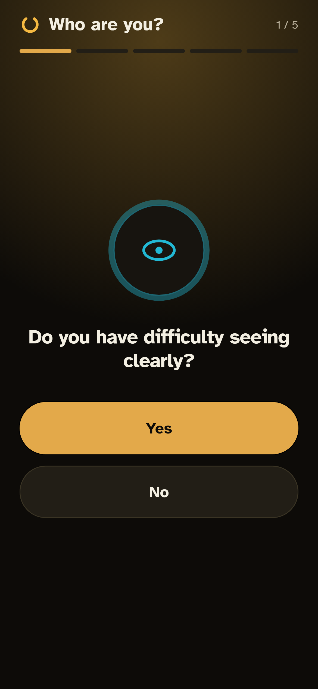<br>Onboarding</td>
<td align="center">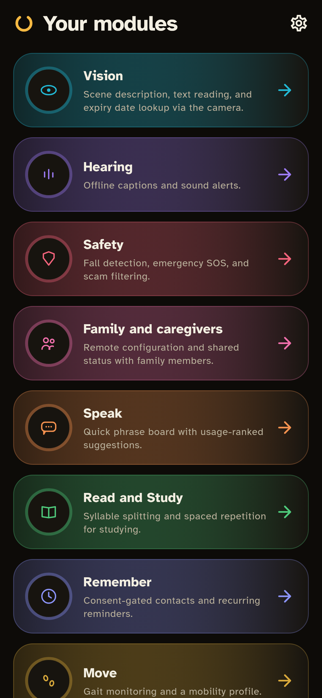<br>Home</td>
<td align="center">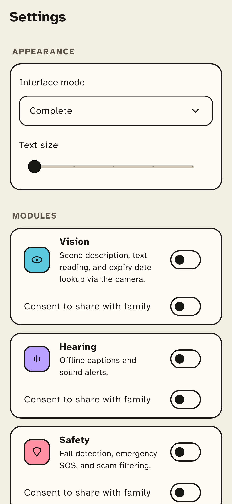<br>Settings</td>
</tr>
<tr>
<td align="center">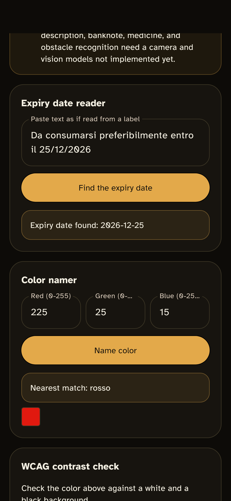<br>Vision</td>
<td align="center">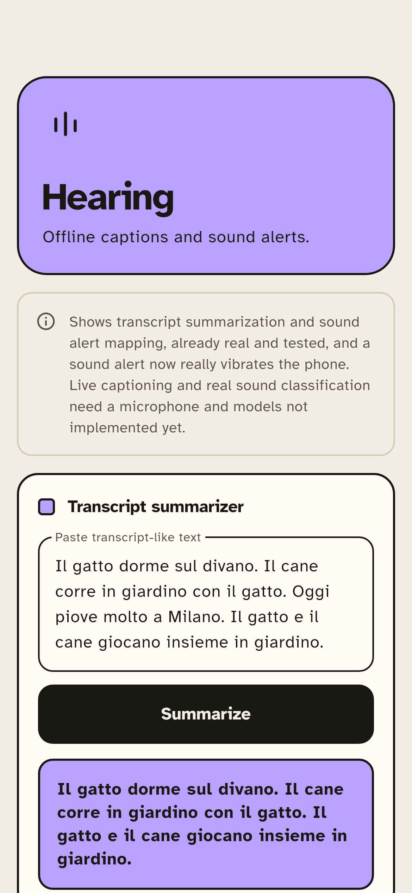<br>Hearing</td>
<td align="center">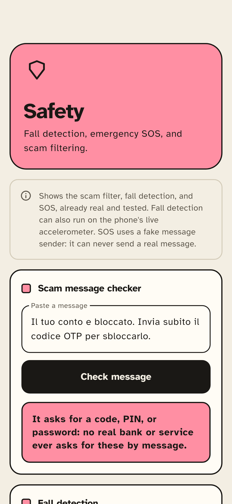<br>Safety</td>
</tr>
<tr>
<td align="center">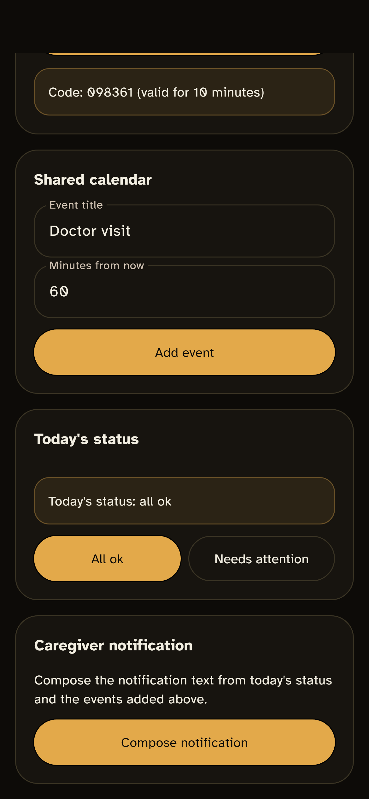<br>Family</td>
<td align="center">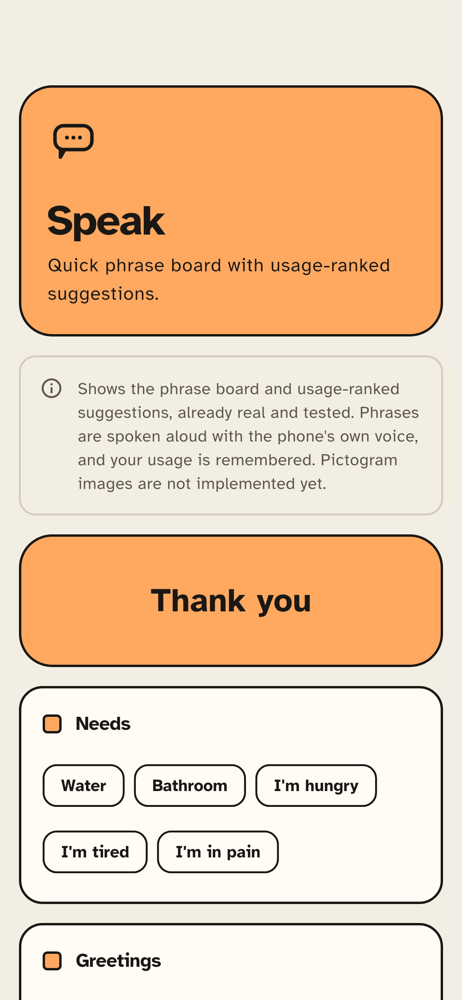<br>Speech</td>
<td align="center">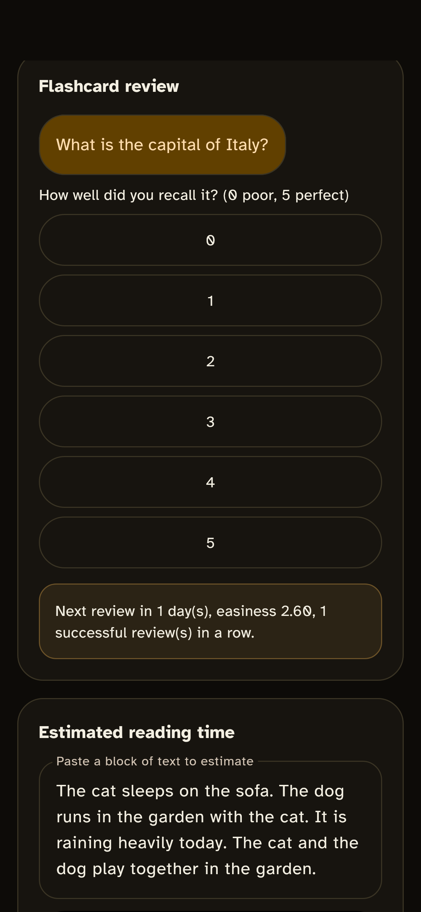<br>Reading</td>
</tr>
<tr>
<td align="center">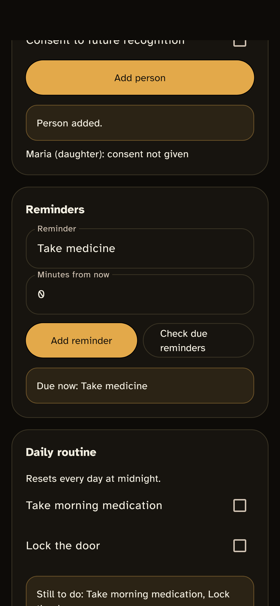<br>Memory</td>
<td align="center">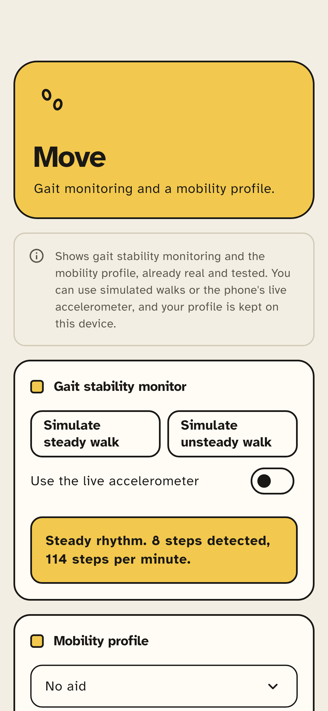<br>Mobility</td>
</tr>
</table>

The file names keep their original names so already published links
stay valid.

## Features

- **Onboarding.** Five tap-only questions with a progress bar and a badge
  for the module each question is about. The outcome is computed by
  `OnboardingController.computeOutcome`, a pure function covered by unit
  tests: vision difficulty selects the voice-first high-contrast mode,
  hearing difficulty the visual-with-vibration mode, a preference for
  simplicity the simple mode, otherwise the complete mode. Vision,
  hearing, safety and caregiver answers enable the matching modules.
- **Home.** The wordmark, a large headline and one solid-color tile per
  enabled module, two per row (one per row in the simple and
  high-contrast interface modes).
- **Eight module screens** under `lib/src/modules/`, each opening with a
  `ModuleHeader` and a note stating what is real and what is not:
  Vision (expiry dates, color naming, contrast), Hearing (summaries,
  captions, sound alerts), Safety (scam filter, fall detection, a SOS
  countdown on a fake sender that can never send a message, check-ins),
  Family (pairing codes, shared calendar, daily status), Speech (phrase
  board, usage suggestions, sentences), Reading (syllables, spaced
  repetition, reading time), Memory (consent-gated people, reminders,
  routine checklist), Mobility (gait monitor on simulated walks,
  mobility profile, rest breaks).
- **Settings.** UI mode, text scale, per-module enable and consent
  switches, the medical and safety disclaimer, and a developer mode that
  reveals a diagnostics screen.
- **Durable encrypted storage.** On launch the app opens a SQLCipher
  database in its private support directory. The passphrase is 32 random
  bytes generated on first launch and kept in the Android keystore through
  `flutter_secure_storage`. Profile, enabled modules, consent and each
  module's own data (people, reminders, calendar events, phrase usage,
  review progress, mobility profile) survive restarts. If the database
  cannot be opened the app falls back to memory instead of crashing.
- **Real device features.** Speech and Reading speak with the phone's
  text-to-speech engine, Hearing alerts vibrate the phone with their
  pattern, and Safety and Mobility can run the real fall detector and
  gait monitor on the live accelerometer (a switch on each screen) as
  well as on simulated data.
- **Consent and capabilities.** `AppConsentStore` and
  `AppCapabilityGate` implement `lumen_core`'s contracts.
- **Design system.** A flat, light "paper and ink" identity: ink outlines,
  no gradients or shadows, and one solid color per module, applied
  through `ModuleScope`. See
  [docs/design-system.md](docs/design-system.md).
- **Localization.** English only, through a small hand-written
  `AppStrings` delegate.

## What is not included

- **Voice input in onboarding.** Every question is answered by tap. Real
  voice input needs speech recognition through native bridges that do
  not exist yet.
- **Camera and microphone.** Vision and Hearing run their logic on typed
  or sample input: scene description, banknote and medicine recognition,
  live captions and sound classification need models that are not
  bundled. Only the accelerometer is read live.
- **Operating system permission requests.** Nothing the app uses today
  needs a runtime permission (text-to-speech, vibration and the
  accelerometer are normal permissions), so `AppCapabilityGate` still
  tracks an in-memory set and calls no platform permission API.
- **Notifications for reminders.** Reminders are checked inside the app.
- **Testing on physical hardware.** The release build was installed and
  driven in an Android emulator (onboarding, navigation, restart
  persistence, text-to-speech engine call, live accelerometer fall
  detection), but not on a real phone.
- **Play Store distribution and a release workflow.** Release APKs are
  built by hand and published on GitHub Releases, signed with a project
  key that is not in this repository. CI runs `flutter analyze` and
  `flutter test` only.
- **Manual screen reader testing.** `Semantics` labels, minimum touch
  targets and dynamic text scaling are built in, but TalkBack and
  VoiceOver have not been tried. Treat that as required manual QA before
  any release.

## Quickstart

A Flutter SDK compatible with `>=3.24.0` and Dart `^3.5.0` is required.
Dependencies are git dependencies pinned to tags, so the first
`pub get` needs network access.

```
flutter pub get
flutter run
```

## Building an Android APK

The `android/` directory holds the Flutter Android platform
(application id `org.lumenassistive.lumen_app`, minimum SDK 24). With
the Android SDK and a JDK 17 installed and configured in Flutter:

```
flutter build apk --release                  # one universal APK
flutter build apk --release --split-per-abi  # smaller per-architecture APKs
```

Release signing reads `android/key.properties` (`storeFile`,
`storePassword`, `keyAlias`, `keyPassword`), which is ignored by git. If
the file is missing the build falls back to the debug key, so the
command always works, but only an APK signed with the real key can
update an installed copy of the app. Keep that key and its passwords
backed up: losing them means users must uninstall before they can
install a new build.

Published APKs and their SHA-256 checksums are attached to each
[GitHub release](https://github.com/lumen-assistive/lumen-app/releases).
On a phone, allow installs from your browser or file manager, then open
the downloaded file. Most current phones need the `arm64-v8a` build;
the universal APK works on any supported architecture.

## Device plugins

| Package | Used for | License |
|---|---|---|
| `sqflite_sqlcipher` | Encrypted database | MIT (SQLCipher: BSD-style) |
| `flutter_secure_storage` | Keeping the database passphrase in the Android keystore | BSD-3-Clause |
| `path_provider` | The app's private storage directory | BSD-3-Clause |
| `flutter_tts` | Text-to-speech through the phone's own engine | MIT |
| `sensors_plus` | Reading the accelerometer | BSD-3-Clause |
| `vibration` | Vibration patterns | BSD-2-Clause |

## Project layout

```
lib/
  main.dart                    entry point
  src/
    app.dart                   root widget, loads the profile, builds the router
    routing/                   go_router routes and the module screen switch
    onboarding/                questions, answers, controller, module catalog
    home/                      the module list
    modules/                   eight module screens
      widgets/                 ModuleHeader, ModuleBadge, ToolCard, ToolOutput,
                               ModuleNote, StyledDropdown
    settings/                  settings screen
    diagnostics/               developer diagnostics
    storage/                   AppDatabase, in-memory and SQLCipher implementations
    consent/                   consent store and capability gate
    theme/                     colors, theme, ModuleScope, logo mark, module icons
    l10n/                      AppStrings
android/                       Flutter Android platform, release signing hook and shrinker rules
assets/fonts/                  Atkinson Hyperlegible, with its OFL.txt
docs/                          design system and screenshots
test/                          unit and widget tests, plus the screenshot capture
```

## Configuration

There is no runtime configuration. Module versions come from
`pubspec.yaml`: `lumen_sdk` and `lumen_core` at `v0.1.0`, and the eight
`lumen_plugin_*` packages at `lumen-plugins` `v0.3.0`.

## Development

```
flutter pub get
flutter analyze --fatal-infos
flutter test
```

To regenerate the screenshots:

```
flutter test test/screenshots
```

Install the shared commit message hook before committing:

```
git config core.hooksPath .githooks
```

## Testing and CI

The suite covers the onboarding outcome, settings persistence through
the repositories, the home screen and every module screen's real tools,
plus colour contrast checks for the palette using the real
`ContrastChecker` from `lumen_plugin_vision`. CI runs `flutter analyze`
and `flutter test` through the organization's reusable workflow, plus a
content guard that rejects forbidden references in tracked files, on
every push to `main` and every pull request.

## Documentation

The app guide, with one page per module screen, the design system and
the accessibility notes live in the `/docs` wiki of the project website,
whose source is in
[lumen-website](https://github.com/lumen-assistive/lumen-website).

## Contributing and security

See [CONTRIBUTING.md](CONTRIBUTING.md) for the workflow and
[SECURITY.md](SECURITY.md) for private vulnerability reporting. Everyone
participating is expected to follow the [Code of Conduct](CODE_OF_CONDUCT.md).

## License

Apache License 2.0, see [LICENSE](LICENSE).

The bundled Atkinson Hyperlegible font (`assets/fonts/`) is Copyright 2020
Braille Institute of America, Inc., licensed separately under the SIL Open
Font License 1.1: see `assets/fonts/OFL.txt`.
