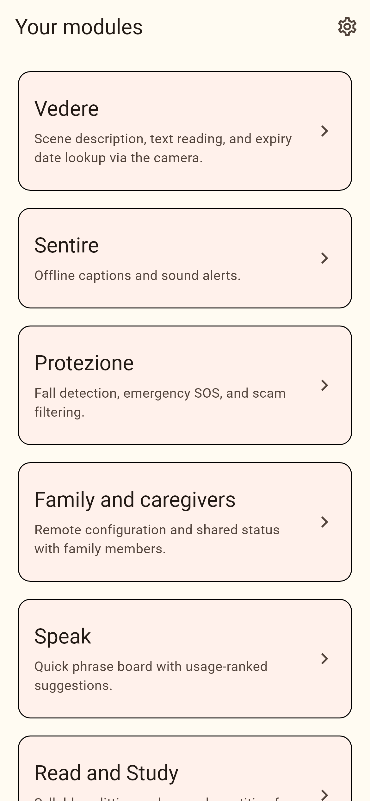
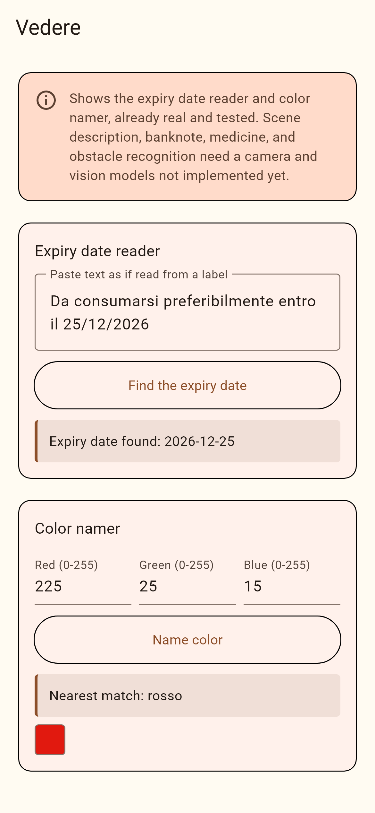
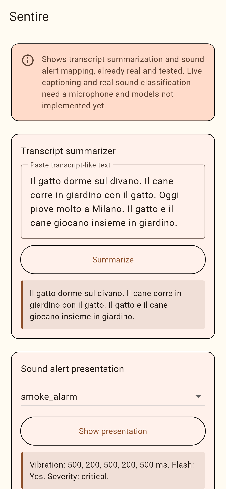
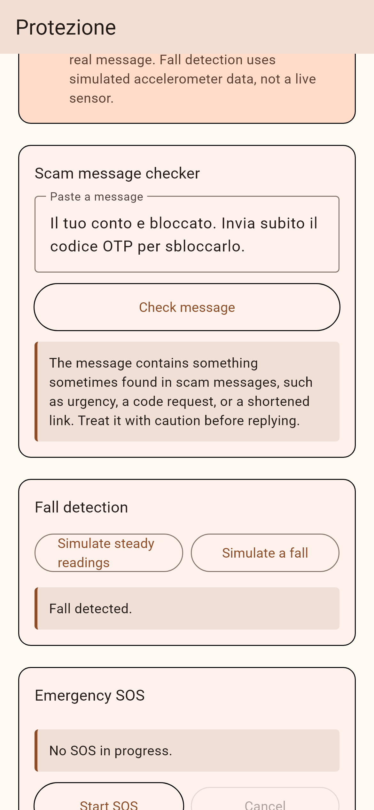
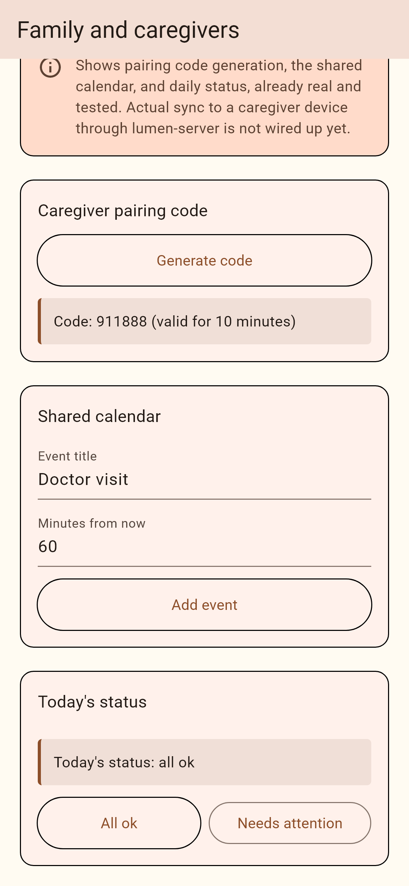
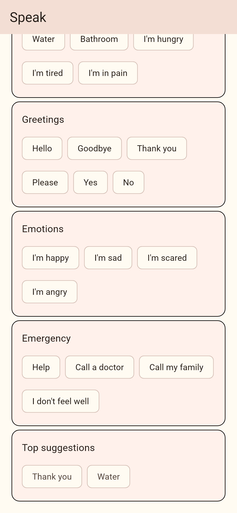
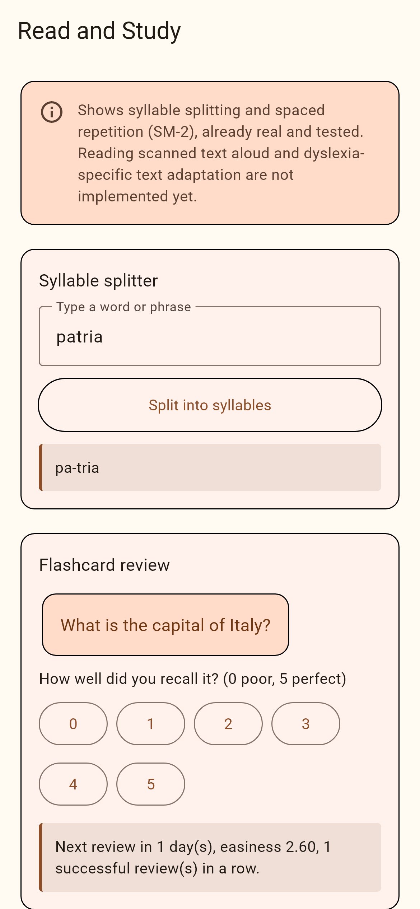
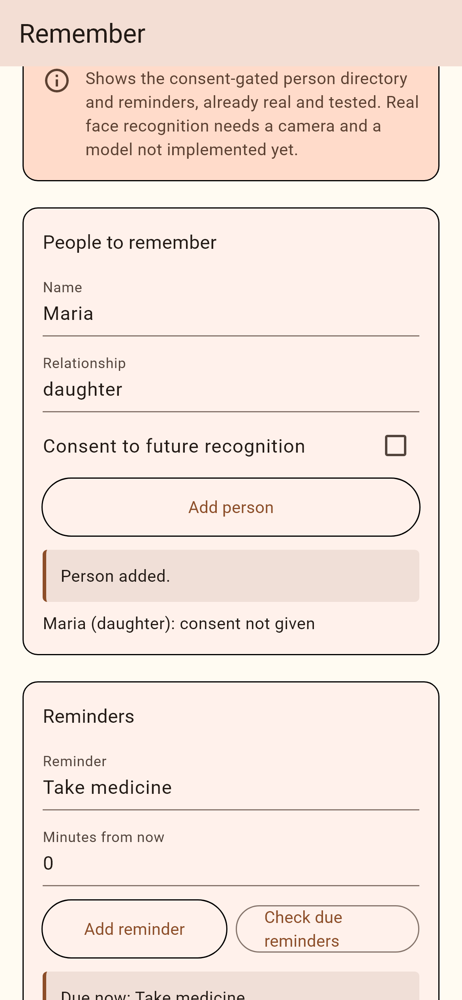
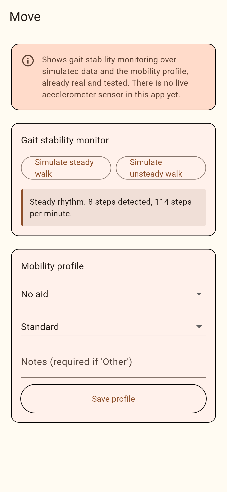

<p align="center">
  
</p>

# lumen-app

The Flutter application for [Lumen](https://github.com/lumen-assistive):
onboarding, adaptive UI, module host, settings, and local storage.
Depends on [`lumen_sdk`](https://github.com/lumen-assistive/lumen-sdk)
and [`lumen_core`](https://github.com/lumen-assistive/lumen-core),
both pinned to their `v0.1.0` tags.

## What this release includes

- **Onboarding**: a five-question flow (large-button, high-contrast,
  screen-reader labeled) that decides the UI mode and which modules to
  enable, built entirely on `OnboardingController.computeOutcome`, a
  pure function fully covered by unit tests.
- **Adaptive UI**: four `UiMode`s (voice-first high contrast, visual
  with vibration, simple, complete), each with its own light and dark
  `ThemeData` built in `AppTheme`. An original palette (warm amber
  accent on ink/cream neutrals): no gradients, no glassmorphism, no
  emoji icons.
- **Module host**: a home screen listing the modules the user enabled;
  tapping one opens that module's real screen (see `lib/src/modules/`),
  backed directly by the matching package in
  [`lumen-plugins`](https://github.com/lumen-assistive/lumen-plugins)
  rather than a generic placeholder.
- **Settings**: UI mode switch, dynamic text scale, per-module enable
  and consent toggles, the project's required medical/safety
  disclaimer, and a developer mode revealing a diagnostics screen.
- **Local storage**: `AppDatabase` interface with two implementations:
  `InMemoryAppDatabase` (used by the whole test suite and, for now, by
  the running app) and `SqlCipherAppDatabase` (production-ready code
  using `sqflite_sqlcipher`, not yet wired into `main()`).
- **Localization**: Italian as the default locale, English as the
  fallback, via a small hand-written `AppStrings` delegate.

## What this release deliberately does not include, and why

- **Voice input during onboarding.** Every question is answered by tap.
  Real voice input needs on-device speech recognition through
  `lumen-core`'s native bridges, which do not exist yet (see that
  repository's README). A microphone button that does not work would
  be worse than not having one.
- **Camera, microphone, and live sensor input.** Every one of the eight
  module screens runs its package's real business logic directly (see
  `lib/src/modules/`), with a visible note on each screen stating
  exactly which original feature needs a camera, microphone, live
  accelerometer, real text-to-speech, or real SMS sending that does
  not exist in this environment yet, consistent with each package's
  own README in [`lumen-plugins`](https://github.com/lumen-assistive/lumen-plugins).
- **Durable encrypted storage at runtime.** `SqlCipherAppDatabase` is
  implemented and ready, but `main()` currently runs on
  `InMemoryAppDatabase`: wiring in the real one needs a per-device
  passphrase (for example via `flutter_secure_storage`) and a real
  documents-directory path (for example via `path_provider`), neither
  of which is a dependency of this package yet. State does not survive
  an app restart until that lands; this is stated plainly rather than
  silently shipped as a gap.
- **Real operating system permission requests.** `AppCapabilityGate`
  tracks a simple in-memory set of granted capabilities; it does not
  yet call into any platform permission API, since no live plugin
  needs a real one yet either.
- **A signed release build.** No Android signing keystore exists yet;
  this repository's CI only runs `flutter analyze` and `flutter test`,
  with no build or release workflow. Setting one up is a follow-up step
  once a keystore and CI secrets exist.
- **Manual screen reader testing.** `Semantics` labels, minimum touch
  targets, and dynamic text scaling are built in, but TalkBack and
  VoiceOver have not been manually exercised against this app in the
  environment it was built in, and that is not claimed anywhere in
  this repository. Treat that as a required manual QA step before any
  release.

## Screenshots

Real screenshots of the app's own widget tree, not mockups: rendered from
`test/screenshots/capture_screenshots_test.dart` with the real fonts loaded
in (`flutter test` otherwise substitutes a fallback test font), each module
screen populated by actually running its tools once before capture. See
`docs/screenshots/` for the full-resolution files and that test file for how
to regenerate them.

<table>
<tr>
<td align="center"><br>Home</td>
<td align="center"><br>Vedere</td>
<td align="center"><br>Sentire</td>
<td align="center"><br>Protezione</td>
</tr>
<tr>
<td align="center"><br>Famiglia</td>
<td align="center"><br>Parlare</td>
<td align="center"><br>Leggere e Studiare</td>
<td align="center"><br>Ricordare</td>
</tr>
<tr>
<td align="center"><br>Muoversi</td>
</tr>
</table>

## Development

This repository's correctness is verified by its CI (`flutter
analyze`, `flutter test`) on GitHub-hosted runners, and locally with a
working Flutter installation:

```
flutter pub get
flutter analyze --fatal-infos
flutter test
```

Install the shared commit message hook before committing:

```
git config core.hooksPath .githooks
```

See [CONTRIBUTING.md](CONTRIBUTING.md) for the full workflow.

## License

Apache License 2.0, see [LICENSE](LICENSE).
